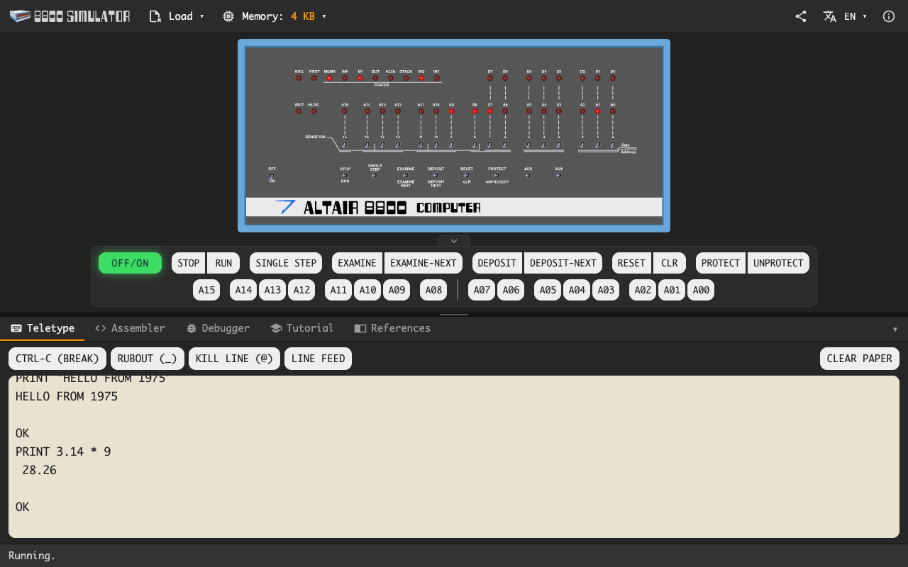
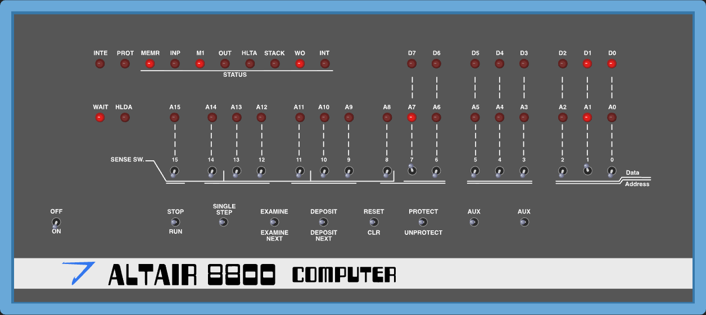
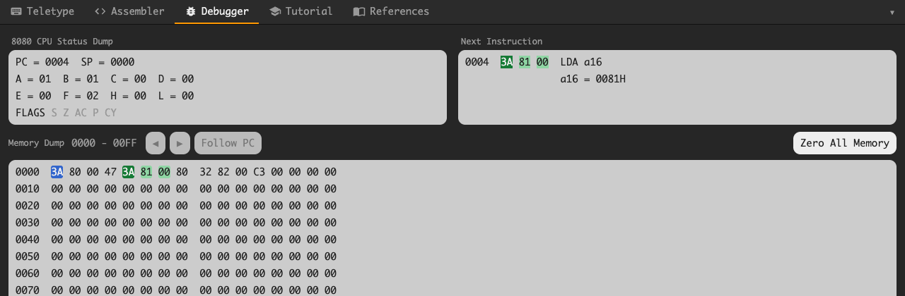
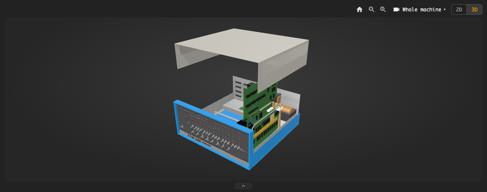
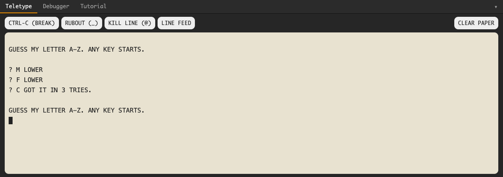

<p align="center">
  <picture>
    <source media="(prefers-color-scheme: dark)" srcset="images/8800-simulator-logo-text-white.svg">
    
  </picture>
</p>

# Altair 8800 Simulator

[](https://github.com/wixette/8800-simulator/actions/workflows/test.yml)

The 1975 computer that started the personal computer revolution, in
your browser. Toggle 8080 machine code in through a working front
panel, watch it run on the lamps, then install a memory board and boot
Microsoft's original 4K BASIC on a simulated Teletype - or write your
own programs in Intel's 8080 assembly language, and assemble them
straight into memory.

**[▶ Try it online](https://wixette.github.io/8800-simulator/)**, with
nothing to install.



**The route through it:**
[1. Try it](#1-try-it-in-a-minute) →
[2. The front panel](#2-meet-the-front-panel) →
[3. A program by hand](#3-your-first-program-by-hand) →
[4. Around the simulator](#4-around-the-simulator) →
[5. The Teletype](#5-the-teletype) →
[6. 4K BASIC](#6-microsoft-4k-basic) →
[7. Assembly](#7-write-it-in-assembly) →
[8. More programs](#8-more-programs) →
[9. For developers](#9-for-developers)

## 1. Try it in a minute

1. Open the simulator, [online](https://wixette.github.io/8800-simulator/)
   or [on your own machine](#run-it-locally).
2. Open **Load**, and choose **Pattern shift** under *Front Panel
   Examples*.
3. Click **RUN**, on the strip of buttons under the panel or on the
   panel's own RUN switch.

A pattern now walks across the data lamps, D7–D0. That is a real
program: eight bytes of 8080 machine code, running at the Altair's
own 2 MHz. Click **STOP** to stop it.

## 2. Meet the front panel

The Altair 8800 had no screen and no keyboard. This panel was the
whole of the way in and out.



**The lamps** show the machine as it is:

| Lamps | Show |
| --- | --- |
| A15–A0 | The address bus: the memory address the CPU is at |
| D7–D0 | The data bus: the byte at that address |
| STATUS, WAIT | What the CPU is doing. WAIT is lit while it is stopped, and HLTA too when a HLT stopped it |
| INTE | Interrupts are enabled: lit by EI, put out by DI and RESET |
| PROT | The memory board at the address shown is protected |

**The switches** are how you talk to it:

| Switch | What it does |
| --- | --- |
| OFF/ON | Power. Memory comes up full of random bytes, as on the real one |
| A15–A0 | An address, up for 1 and down for 0. A7–A0 is also the byte to store. Programs can read A15–A8 as the *sense switches* |
| EXAMINE · EXAMINE NEXT | Show the byte at the address on the switches · at the next address |
| DEPOSIT · DEPOSIT NEXT | Store A7–A0 at the address shown · at the next address |
| RESET · CLR | Send the CPU back to 0000H · clear the serial boards, dropping keys typed and not yet read |
| RUN · STOP | Run the program from where the CPU is · stop it |
| SINGLE STEP | Run one instruction |
| PROTECT · UNPROTECT | Protect the memory board at the address shown (EXAMINE an address on it first), so that neither DEPOSIT nor a program can change it · unprotect it. Each 4 KB board has its own; everything starts unprotected |
| AUX | Nothing: MITS left both spare, for boards added later |

The switches come in groups of three because 8080 programmers wrote
bytes in octal: `00 111 010` is 072 octal, or 3AH. Click the panel's
own switches, or the large buttons on the strip under it, which are
easier to hit and show which switches are up. The small arrow on the
strip's top edge folds it away.

**One simplification.** SINGLE STEP here always runs one whole
instruction, as the Altair's Operator's Manual describes it. The
circuit itself, MITS's *Theory of Operation* says, stopped after each
machine cycle, so one instruction could take up to five presses.
Stopping only between instructions keeps a step about the program
rather than the bus. It also means the STATUS lamps always show the
CPU about to fetch its next instruction - MEMR, M1 and WO - or, after
a HLT, MEMR, HLTA and WO. INP, OUT and STACK belong to cycles inside
an instruction, so they stay dark; and while a program runs the lamps
hold still, rather than glowing with every cycle as the real ones did.

## 3. Your first program, by hand

This is how an Altair owner put in a program in 1975: one byte at a
time, on the switches. It adds 1 and 2. The same steps are in the
simulator's **Tutorial**, under the panel, to follow as you go.

```
        LDA 0080H  ; 00 111 010
                   ; 10 000 000
                   ; 00 000 000
        MOV B,A    ; 01 000 111
        LDA 0081H  ; 00 111 010
                   ; 10 000 001
                   ; 00 000 000
        ADD B      ; 10 000 000
        STA 0082H  ; 00 110 010
                   ; 10 000 010
                   ; 00 000 000
        JMP 0000H  ; 11 000 011
                   ; 00 000 000
                   ; 00 000 000
```

 1. Turn on the Altair 8800 with the OFF/ON switch.
 1. Set switches A7–A0 to 00 111 010 (up for 1, down for 0).
 1. Click **DEPOSIT**.
 1. Set switches A7–A0 to 10 000 000.
 1. Click **DEPOSIT NEXT**.
 1. Repeat steps 4–5 to enter the following bytes one by one: 00 000 000, 01 000 111, 00 111 010, 10 000 001, 00 000 000, 10 000 000, 00 110 010, 10 000 010, 00 000 000, 11 000 011, 00 000 000, 00 000 000.
 1. Set switches A7–A0 to 10 000 000.
 1. Click **EXAMINE**.
 1. Set switches A7–A0 to 00 000 001 (the first number to be added, or 1 in decimal).
 1. Click **DEPOSIT**.
 1. Set switches A7–A0 to 00 000 010 (the second number to be added, or 2 in decimal).
 1. Click **DEPOSIT NEXT**.
 1. Click **RESET**.
 1. Click **RUN** and wait for a few seconds.
 1. Click **STOP**.
 1. Set switches A7–A0 to 10 000 010 (the address that holds the sum).
 1. Click **EXAMINE**.
 1. The data lamps D7–D0 show the result 00 000 011 (3 in decimal).
 1. Turn off the Altair 8800.

At step 18 the panel looks like the picture in
[section 2](#2-meet-the-front-panel): A7 and A1 lit for the address
0082H, and D1 and D0 for the answer.

## 4. Around the simulator

Everything is on one screen: the panel, a toolbar above it, a dock of
tools below it, and a status line along the foot.

- **The toolbar.** **Load** puts a program in. **Memory** installs
  256 bytes, as the Altair shipped, or 4 KB or 8 KB, as if you had
  fitted one or two 88-4MCS boards. Fitting a board meant opening the
  case, so this switches the machine off. On the right are **Share**,
  the language (ten of them), and **About**.
- **The dock** holds five tabs, one at a time: the **Teletype**, the
  **Assembler**, the **Debugger**, the **Tutorial**, and the
  **References** (the source code and further reading). On a phone the
  tabs are icons. Click a tab to open it, ▾ to fold the dock away,
  and drag the handle above it to share the height with the panel.
  Whatever you load, the dock opens on the Debugger to show it
  arriving.
- **The status line** says what just happened, and why a greyed-out
  control is greyed out.
- **2D | 3D**, at the top right of the panel, swaps the front panel for
  the whole machine in 3D, and back (below).

The **Debugger** is a view the real Altair never had. Step through a
program with SINGLE STEP and watch it work:



- **The registers**, with the flags S Z AC P CY lit when set.
- **The next instruction**: its address, its bytes, its mnemonic with
  the operand named as instruction tables name it (`LDA a16`,
  `MVI B,d8`), and the operand's value this time.
- **The memory dump**, one 256-byte page at a time, with the
  instruction at the program counter marked. With more than 256 bytes
  installed, a map strip above it shows every page, shaded by how full
  it is. Click a page to see it, or use **Follow PC**.
- **Changing a byte**: with the machine stopped, click a byte in the
  dump and type two hex digits. The byte changes and the next one is
  picked, so `3e8cd3ff` fills four in a row; the arrow keys move, and
  Esc stops. A protected board refuses, as it refuses DEPOSIT.

### The machine in 3D

**3D** shows the whole box: the case, the chassis, the power supply,
the bus, and each card in its slot. It is the same machine as the 2D
panel, not a picture of it: click a switch on it and it does what the
2D switch does, and its lamps light as the 2D lamps do.



- **Look around:** drag to turn it, right-drag or two fingers to move
  it, scroll or pinch to zoom; ⌂ brings it back. With the view
  focused (Tab), the arrow keys turn it, Shift and the arrows move it,
  and + and − zoom.
- **Views** picks where to look from - the front panel, the whole
  machine, inside from above, the rear. **Show**, the icon beside it,
  picks what is drawn: everything, the case faded or hidden, the
  electronics alone, or one key part - the CPU card, the memory, the
  serial cards, the bus, the power supply - glowing in a faded machine;
  it turns orange while the machine is not drawn whole. Pointing at a part names it and says what it does.
- **Take it apart:** switch the machine OFF, then click the lid to
  take it off, then a card to pull it, a transformer, the chassis...
  in the order the real machine allows; a part in the way says so.
  Click a part again to put it back. **Views ▸ Taken apart** takes
  everything out at once, and any other view puts it back.
- **No power while it is apart.** OFF/ON will not switch on a machine
  with anything out. Loading a program puts it back together first,
  and so does going back to 2D.
- The cards follow the **Memory** menu: 256 bytes is the 1K card, 4 KB
  one 88-4MCS, 8 KB two.
- The Tutorial's first chapter, **Meet the Machine**, walks through
  the panel and the parts behind it, pointing at each one.

The 3D view needs WebGL 2, and loads only the first time you choose
it (about 5 MB). How the model was made, and from what, is in
[docs/3d-model.md](docs/3d-model.md).

## 5. The Teletype

The Altair's terminal was a Teletype ASR-33: a keyboard and a printer
on paper, upper case only. Here it sits on an 88-SIO serial board, at
ports 00H and 01H (and an 88-2SIO at 10H and 11H). Nothing echoes by
itself: a program has to be running and reading the board.



Try the *Teletype Examples* from the Load menu, in this order:

1. **Teletype hello** prints `HELLO, WORLD!` and stops.
2. **Teletype echo** prints whatever you type.
3. **Teletype echo with lamps** does the same, and shows each key's
   ASCII code on the data lamps: press A and `01000001` lights up.
4. **Guess my letter** is a game. It thinks of a letter and says
   HIGHER or LOWER. Halve the alphabet each time and 26 letters fall to
   five tries.

The keys a PC keyboard lacks, such as BREAK, RUBOUT and LINE FEED, are
along the top of the paper.

## 6. Microsoft 4K BASIC

The Altair's first piece of software was Microsoft's first product:
[Altair BASIC 3.2](http://altairbasic.org), written in 1975 by Bill
Gates, Paul Allen and Monte Davidoff. It runs here, unmodified.

1. In **Memory**, choose 4 KB (or 8 KB, for more room).
2. In **Load**, choose **Microsoft 4K BASIC**.
3. Click **RUN**, and open the **Teletype**.
4. Answer BASIC's questions: Enter, Enter, then Y.

```
MEMORY SIZE?
TERMINAL WIDTH?
WANT SIN? Y

727 BYTES FREE

BASIC VERSION 3.2
[4K VERSION]

OK
PRINT 3.14 * 9
 28.26

OK
```

727 bytes is all a 4 KB machine leaves you, which is exactly what the
name means. Load it and look at the memory map in the Debugger before
pressing RUN, and you can see BASIC filling fifteen of the sixteen
pages. The Tutorial walks through it, including what loading it here
skips: toggling in a 28-byte boot loader by hand, then waiting seven
minutes for the paper tape.

The BASIC tape is in [roms/](./roms/), and [roms/NOTICE](./roms/NOTICE)
explains what it is and why it is not under this repository's licence.
**Binary File…** in the Load menu loads an image of your own instead.

## 7. Write it in assembly

Section 3 put a program in byte by byte, the way an owner did in 1975.
Intel's answer, the same year, was assembly language: you write
`ADD B`, and an assembler works out that it is `80`. The **Assembler**
tab, under the panel, takes the language exactly as Intel's *8080
Assembly Language Programming Manual* defines it, macros and all.


Here is section 3's program again, with names for its addresses
instead of the numbers. It makes exactly the bytes you toggled in:

```
FIRST   EQU     80H             ; the first number
SECOND  EQU     FIRST+1         ; the second, the byte after it
SUM     EQU     FIRST+2         ; and where the sum goes

START:  LDA     FIRST           ; A = the first number
        MOV     B,A             ; keep it in B
        LDA     SECOND          ; A = the second
        ADD     B               ; A = A + B
        STA     SUM             ; store the sum
        JMP     START           ; and do it all again
```

1. Open the **Assembler** tab and type it in, or choose
   **Examples › Add two numbers**.
2. Beside each line, the listing shows its address and the bytes it
   makes, as you type. A mistake is marked on its line, with what is
   wrong under the source.
3. Click **Assemble** (or press Ctrl+Enter, ⌘+Enter on a Mac). The
   program goes into memory and RESET is pressed.
4. DEPOSIT 1 at 0080H and 2 at 0081H, as in section 3, then RUN, STOP
   and EXAMINE 0082H: 00 000 011.

What it takes is the whole of the manual's language: every
instruction, labels, `EQU` and `SET`, `DB`, `DW` and `DS`, expressions
and `$`, `IF` and `ENDIF`, and macros, whose labels are local to each
use as Intel specified. Its **Examples** menu has every example
program, from switches to lamps to macros ([examples/](examples/README.md)).
Once a program is assembled, the line the program counter is on is
marked in green as you SINGLE STEP or STOP, and the line the caret is
on is banded across to its bytes. In the editor's corner, **Copy**
takes the source with you, and **Clear** starts afresh (Undo brings it
back). On a phone, the source and its bytes take turns, under the
**Source** and **Bytes** tabs. The design and its decisions are in
[docs/assembler.md](docs/assembler.md).

## 8. More programs

- **[Kill the Bit](examples/kill-the-bit.md)**, the 1975 front-panel
  game by Dean McDaniel: a lit bit runs across the upper address lamps,
  and you kill it by flipping the sense switch under it at the right
  moment.
- **Fourteen example programs** in all, each written in assembly
  language: **Load** puts one in memory, ready to RUN, and the Assembler's
  **Examples** shows its source. See [examples/](examples/README.md).
- **Your own, in assembly language**: in the **Assembler** tab
  ([section 7](#7-write-it-in-assembly)).
- **Your own, as bytes**: paste them in hex with **Load › Hex Bytes…**,
  or read a binary with **Load › Binary File…**.
- **Share one as a link**: **Share** copies a link that opens the
  simulator with your program loaded, or with the whole machine as it
  is now. A link can be written by hand too, and put in a document
  next to the program's listing, like this one, which lights 10001100
  on the data lamps and halts:
  **[Run it](https://wixette.github.io/8800-simulator/?hex=3E8CD3FF76)**.

## 9. For developers

### Run it locally

Serve the directory over HTTP and open it. With no web server
installed, Python has one built in:

```
python3 -m http.server 8000
```

Then open <http://localhost:8000/>. To deploy, copy the whole
directory to a web server; there is nothing to build, and no
dependencies.

Opening `index.html` straight off the disk does not work, since
v1.7.0: the page's scripts are ES modules, and a browser runs no module
in a `file://` page. Opened that way, the page shows only a notice that
says so and gives the command above.

### Deploying behind a cache

Every file `index.html` names carries the version, `css/style.css?v=1.7.0`,
and so does every module the scripts import, through the page's import
map. A release asks for new names, so a cache can keep each file as long
as it likes and still never give an old one to the new page. Only
`index.html` itself must not be kept. On a server or a CDN that lets you
set the headers:

| What | `Cache-Control` |
| --- | --- |
| `index.html` (and `/`) | `no-cache`: kept, but checked with the server each time, which costs a reply with no body when nothing changed |
| Everything asked for with `?v=` | `public, max-age=31536000, immutable` |
| `package.json`, `examples/`, `roms/` | `no-cache`; the page fetches these itself, and asks for a check anyway |

A CDN must count the query string in its cache key (most do unless told
not to), and should be told to purge `index.html` on each deploy.
GitHub Pages sets no headers you can change and keeps everything for 10
minutes, so there a release reaches everyone within 10 minutes.

The version is kept in one place, `package.json`; the names in
`index.html` are copies, written from it and never by hand. Set it with
npm, which writes them too:

```
npm version 1.7.0        # or: npm version patch | minor | major
```

It sets the version, then runs `npm run stamp`
([tools/stamp.mjs](tools/stamp.mjs)) to write it into `index.html`'s
file names and import map, and stops there: it does not commit or tag
([.npmrc](.npmrc)), since a release is tagged on GitHub, on its merge
commit. Commit the two files as usual. A version changed any other way,
by hand in `package.json`, needs `npm run stamp` after it; until then
`npm test` fails and says so, so a release cannot go out half stamped.

### The logo and icons

The logo is in [images/](images/) in three forms: the machine alone, 16:9
(`8800-simulator-logo.svg`), and the machine with its name, 8:1, in
white for dark backgrounds and black for light ones
(`8800-simulator-logo-text-white.svg`, `-text-black.svg`). The toolbar
shows the one with the name, and on a phone the machine alone; this
README shows the name in whichever colour suits the reader's theme.

The favicons and home screen icons are drawn from the 16:9 one, and
kept with it in `images/`: `favicon.svg`, `favicon.ico` (16, 32 and 48
pixels), and the 180, 192 and 512 pixel PNGs that `index.html` and
[manifest.webmanifest](manifest.webmanifest) name. After a change to
the logo, draw them again (it needs Chrome, as the browser checks do):

```
npm run icons
```

`npm test` fails until they have been, since it checks that the SVG
favicon still has the logo's drawing.

### How it is built

| File | What it is |
| --- | --- |
| [index.html](index.html), [css/style.css](css/style.css) | The page: toolbar, panel, dock, dialogs |
| [js/main.js](js/main.js), [js/app.js](js/app.js) | The page's one script, and the app it starts; every file is an ES module |
| [js/8080.js](js/8080.js) | The Intel 8080 CPU core, [maly/8080js](https://github.com/maly/8080js) |
| [js/sim8800.js](js/sim8800.js) | The machine: memory, the front panel's logic, the ports |
| [js/sio.js](js/sio.js), [js/teletype.js](js/teletype.js) | The serial boards, and the Teletype's paper |
| [js/panel.js](js/panel.js) | The page's own logic, at its core: the status line, About, and building the page |
| [js/panel-front.js](js/panel-front.js) | The front panel: its switches, lamps and sounds, and the big switches under it |
| [js/panel-load.js](js/panel-load.js) | Putting a program in: Load, the examples, 4K BASIC, files, the Memory menu |
| [js/panel-debug.js](js/panel-debug.js) | The Debugger: the memory dump and its editing, the next instruction, the memory map |
| [js/panel-link.js](js/panel-link.js), [js/panel-tty.js](js/panel-tty.js), [js/panel-dock.js](js/panel-dock.js) | Program links and Share; the Teletype; the dock and its tabs |
| [js/link.js](js/link.js) | The program link format |
| [js/asm8080.js](js/asm8080.js), [js/asmtab.js](js/asmtab.js) | The 8080 assembler, and its tab |
| [js/dropdown.js](js/dropdown.js), [js/dialog.js](js/dialog.js) | The menus and the dialogs |
| [js/l10n.js](js/l10n.js), [js/l10n-3d.js](js/l10n-3d.js) | Every message, in ten languages |
| [js/panel-view.js](js/panel-view.js), [js/panel-tutorial.js](js/panel-tutorial.js) | The 2D / 3D toggle; the Tutorial's chapters and Show chips |
| [js/box.js](js/box.js) | The machine's box: which parts are out, in what order they come out, and so whether it may switch on |
| [js/view3d/](js/view3d/) | The 3D view, loaded when first chosen: the renderer and camera, the 3D panel, the box's parts, the Views and Show menus |
| [model/](model/) | The 3D model: its params, its Blender build (`npm run build:model`), its research, and the built `.glb` |
| [vendor/three/](vendor/three/) | three.js, pinned (`node tools/vendor.mjs`) |
| [tools/stamp.mjs](tools/stamp.mjs), [tools/icons.mjs](tools/icons.mjs), [tools/vendor.mjs](tools/vendor.mjs) | Not part of the page: the version stamp, drawing the icons from the logo, and vendoring three.js |

The design notes say why things are the way they are:
[docs/ui-design.md](docs/ui-design.md) for the layout and its
principles, [docs/ms-basic-4k.md](docs/ms-basic-4k.md) for the
memory, the serial boards, the Teletype and BASIC,
[docs/assembler.md](docs/assembler.md) for the assembler and the
language it takes, [docs/kill-the-bit.md](docs/kill-the-bit.md)
for the address-bus trick Kill the Bit relies on, and
[docs/3d-view.md](docs/3d-view.md) and [docs/3d-model.md](docs/3d-model.md)
for the 3D view and its model.

### Tests

```
npm test
```

Node.js 24, nothing to install. The suite covers the 8080 CPU, the
front panel, the serial boards and the Teletype, the page's own logic
and translations, the link format, the assembler against Intel's
manual, every program in [examples/](examples/), 4K BASIC booting
and running end to end, and the 3D view's logic: the box and the
power, the model against its params, framing, and the toggle. It runs
on each push and pull request.

The page itself - clicks, menus, the Assembler's editor, the layout -
is checked in a headless Chrome:

```
npm run test:browser
npm run test:browser -- sync clear
```

It takes a minute or so and needs Chrome installed (or `CHROME` set to
its path, Chromium too), so it is not part of CI: run it by hand
before a release. The checks are in [tests/browser/](tests/browser/).

The JSDoc types are checked against the code by TypeScript's checker,
which `npx` fetches for the run; nothing is compiled, and the page
runs the files as they are. CI runs it after the tests:

```
npm run typecheck
```

Only the files that start with `// @ts-check` are checked, so far
`js/asm8080.js`, `js/sim8800.js`, `js/box.js` and the 3D view's
framing and views; [tsconfig.json](tsconfig.json)
says how strictly.

### The link format

A link opens the simulator with a program loaded at 0000H, ready to
RUN. The fields go after `?` or `#`:

```
https://wixette.github.io/8800-simulator/?hex=3E8CD3FF76
```

[Try it](https://wixette.github.io/8800-simulator/?hex=3E8CD3FF76):
the bytes are `MVI A,8CH`, `OUT 0FFH` and `HLT`. Click RUN and the
data lamps show 10001100.

The bytes of `hex` can run together, or be separated by `+` or `%20`.
Memory is installed to fit, and zeros at the end do not count.

**Share** writes its links after `#`, which is never sent to the web
server, so a long one is not turned away (GitHub Pages refuses a link
of 16,000 characters). It leaves out whatever a machine just switched
on would have anyway. Memory in use that fits in 256 bytes is written
as hex, so it can be read in the link; past that it is compressed under
`zip`, and 4K BASIC comes to about 4,500 characters instead of 8,300.
Every field is optional:

| Field | Holds |
|---|---|
| `hex` | Memory from 0000H up, in hex |
| `zip` | The same memory, deflated and in URL-safe base64, in place of `hex` |
| `mem` | Installed memory: `256`, `4096` or `8192` (decimal) |
| `pc`, `sp` | The 16-bit registers, in hex |
| `a`, `b`, `c`, `d`, `e`, `h`, `l`, `f` | The 8-bit registers, in hex, `f` being the flags |
| `sw` | The address switches, A15–A0, as a 16-bit hex word |
| `view` | `3d` to open in the 3D view, `2d` for the front panel (since v1.8.0); a link from Share in 3D carries `view=3d` |

A linked machine always opens stopped. The Teletype's paper and the
interrupt enable are not in the link. The format is a promise to
everyone who has put a link in a document: fields may be added, but
never renamed or read differently ([js/link.js](js/link.js)).

## References

- [Wikipedia: Altair 8800](https://en.wikipedia.org/wiki/Altair_8800)
- [Wikipedia: Intel 8080 CPU](https://en.wikipedia.org/wiki/Intel_8080)
- [Intel 8080 instruction set - an opcode encoding quick reference (text)](http://www.classiccmp.org/dunfield/r/8080.txt)
- [Original Altair 8800 manuals - scanned PDFs archived at altairclone.com](https://altairclone.com/altair_manuals.html)
- [Altair 8800 Operator's Manual - the original manual as a scanned PDF](https://altairclone.com/downloads/manuals/Altair%208800%20Operator's%20Manual.pdf)
- [Altair 8800 Operator's Manual v2.0 - an HTML edition by Kevin Cole](https://ubuntourist.codeberg.page/Altair-8800/)
- [Intel 8080 Assembly Language Programming Manual - Intel's original manual as a scanned PDF](http://www.classiccmp.org/dunfield/r/8080asm.pdf)
- [Intel 8080 Assembly Language Programming Manual - an HTML edition by the Grace Hopper Center](https://gracehoppercenter.codeberg.page/8080-assembly/)
- [Demystifying Computers - an open source book by Chris Jones and Jeff Elkner](https://www.openbookproject.net/books/demystcomp/index.html)
- [Wikipedia: Altair BASIC - what it is, and how Microsoft started with it](https://en.wikipedia.org/wiki/Altair_BASIC)
- [MITS Altair BASIC Reference Manual (1975) - the language itself, the startup questions and the error codes](https://altairclone.com/downloads/manuals/BASIC%20Manual%2075.pdf)
- [Altair BASIC 3.2 (4K) - an annotated disassembly of the exact program this simulator runs](http://altairbasic.org)
- [MITS Altair Simulator - another JavaScript simulator, running Microsoft BASIC on a simulated teletype](https://s2js.com/altair/)

## Acknowledgements

The Intel 8080 CPU core is [maly/8080js](https://github.com/maly/8080js).

The 3D view is drawn with [three.js](https://threejs.org) (MIT). Its
model rests on MITS's 1975-76 manuals and board artwork (archived by
bitsavers.org and deramp.com; facts only), the Smithsonian's and the
Computer History Museum's records, and freely licensed photographs by
Wikimedia Commons and Flickr contributors, credited in
[model/research/photo-credits.md](model/research/photo-credits.md).
The model and its data are CC BY-SA 4.0 ([model/LICENSE](model/LICENSE));
the rest of this repository, apart from the BASIC tape, is Apache 2.0.

The Quick Tutorial in the simulator uses an example program from the original [Altair 8800 Operator's Manual](https://altairclone.com/downloads/manuals/Altair%208800%20Operator's%20Manual.pdf).

The interaction design took [another Altair 8800 simulator](https://s2js.com/altair/) as a reference.
